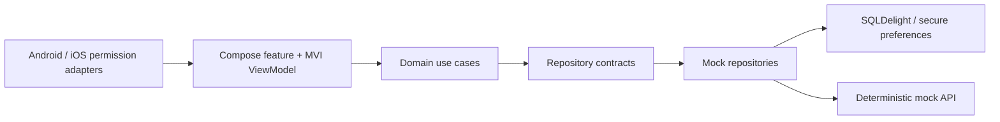

# RestaurantApp architecture

## Current baseline and migration

RestaurantApp is a Kotlin Multiplatform project with shared Compose UI, Kotlin coroutines,
Koin, Ktor, SQLDelight and KVault. The existing `auth`, `orders` and dashboard modules are a
Clean Architecture/MVI template. They are retained only where their infrastructure is reusable;
their generic product workflows are being replaced by restaurant discovery and reservations.

The application has no production backend. All restaurant, availability, booking and payment
data must be deterministic local demo data. A successful payment therefore means only that the
selected demo scenario was approved; it never creates a real charge or restaurant reservation.

## Target dependency flow

Feature modules depend on domain contracts, `commonResources` and the MVI core. Mock data and
persistence implementations remain in data modules, so a real API can later replace them without
changing UI or booking rules.

## Navigation target

`Splash -> Login | Home`; unauthenticated routes are Login, Register and password recovery.
Authenticated primary routes are Home, Reservations, Profile and Settings. Restaurant detail,
payment processing and booking confirmation are transient routes without the bottom bar.

## Data and safety decisions

- Amounts use integer euro cents; floating-point values are never used for money.
- A booking captures its cancellation policy at confirmation time and is immutable except for a
  permitted transition from confirmed to cancelled.
- Payment methods are labels for a simulation. No PAN, CVV, expiry date, wallet SDK or OAuth flow
  is collected or invoked.
- Location and notifications are optional. Discovery falls back to the profile or manually chosen
  city when location is unavailable.
- The local demo session is stored through the existing KVault abstraction. Production identity,
  password reset, payment processing and availability require server-side replacements.

## Delivery sequence

1. Brand the product and replace generic template language.
2. Introduce restaurant and booking domain contracts plus deterministic mock data.
3. Build discovery, detail, availability and reservation flows.
4. Add mock payment scenarios, booking history, cancellation, profile and settings.
5. Complete automated tests and bilingual open-source documentation.
